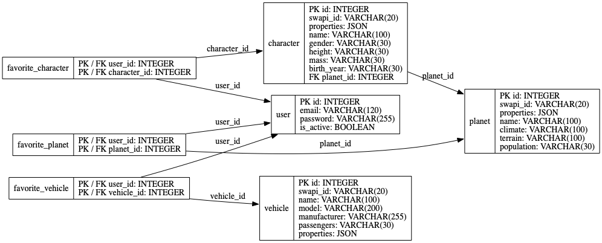

# Star Wars Blog API

[English](README.md) | [Español](README.es.md)

REST API exercise for 4Geeks Academy, built with Python 3.13, Flask, SQLAlchemy, Flask-Migrate and Flask Admin.

Repository: [Krisor1986/Starwars-blog-api](https://github.com/Krisor1986/Starwars-blog-api).

## Run locally

```sh
pipenv --python 3.13
pipenv install
cp .env.example .env
pipenv run upgrade
pipenv run seed
pipenv run start
```

Open http://localhost:3001. The API uses port 3001 so the React blog can keep port 3000. SQLite is stored in `src/instance/starwars.db` and excluded from Git. Keep `.env` local and set `FLASK_APP_KEY` to a development secret. No MySQL or PostgreSQL installation is needed.

The committed migrations create all seven tables and allow password hashes. Existing local records are preserved when applying upgrades. After future column changes, use `pipenv run migrate` followed by `pipenv run upgrade`.

## Create data in Flask Admin

Open http://localhost:3001/admin/ and create:

1. A planet, for example Tatooine.
2. A character, for example Luke Skywalker, selecting Tatooine as Homeworld.
3. A user with email, password and active status.

The Admin stores hashes for passwords created or changed through its form. API responses exclude passwords. Relationships display planet and character names and user emails. Favorite fields are excluded from the user, planet and character forms; use the API to practice adding and removing favorites.

This exercise has no login or authentication. The Admin is intended for local exercise use, not public production hosting.

## Current user

Favorite routes use `CURRENT_USER_ID` from `.env` (default `1`). To select a different existing user in Postman, send the `X-User-ID` header. This is an exercise convention, not authentication. If the selected user does not exist, the API returns 404; an invalid ID returns 400.

## Endpoints

| Method | Path | Success |
| --- | --- | --- |
| GET | `/people` | 200: character list |
| GET | `/people/<people_id>` | 200: character details |
| GET | `/planets` | 200: planet list |
| GET | `/planets/<planet_id>` | 200: planet details |
| GET | `/vehicles` | 200: vehicle list |
| GET | `/vehicles/<vehicle_id>` | 200: vehicle details |
| POST | `/favorite/vehicle/<vehicle_id>` | 201: favorite added |
| DELETE | `/favorite/vehicle/<vehicle_id>` | 200: favorite removed |
| GET | `/users` | 200: users without passwords |
| GET | `/users/favorites` | 200: selected user's favorites |
| POST | `/favorite/planet/<planet_id>` | 201: favorite added |
| POST | `/favorite/people/<people_id>` | 201: favorite added |
| DELETE | `/favorite/planet/<planet_id>` | 200: favorite removed |
| DELETE | `/favorite/people/<people_id>` | 200: favorite removed |

Missing resources or favorites return 404; duplicate favorites return 409. Favorite deletion is scoped to the selected user. API errors return JSON.

Example favorite response:

```json
{"user_id": 1, "planets": [], "people": [], "vehicles": []}
```

Favorites contain the serialized resources, including their IDs and names. All API responses come from the local database. `pipenv run seed` imports the checked-in snapshot of 10 characters, 10 planets and 10 vehicles downloaded from SWAPI.tech, matching the first page shown in the React blog. CRUD endpoints for planets and characters are optional in the assignment and are not implemented. React integration and login are separate exercises.

## Imported data and future React integration

`data/starwars.json` is a snapshot downloaded from the live SWAPI.tech API, with source and download timestamp. It includes the same first 10 items from each category as the React blog. Ships classified as vehicles by SWAPI stay in `/vehicles`; a separate starships catalog is not included.

`pipenv run seed` can be repeated without creating duplicates. It updates imported fields, matches existing records by SWAPI ID or name, and preserves local IDs, users and favorites. Luke and Tatooine created manually are reused. To refresh the snapshot from the live API, run `pipenv run download_data`, then `pipenv run seed`.

Responses include the local `id`, the separate `swapi_id`, the image URL from `breatheco-de/swapi-images`, and a `properties` object with imported details. Related resource URLs are resolved to names during download. Image URLs use the SWAPI ID, never the local ID. API and favorite routes use local IDs.

Obi-Wan's homeworld, Stewjon, is outside the first 10 planets. Its name is preserved in his properties without adding an extra planet to the list. This API is prepared for future integration; the React project has not been changed.

## Postman and verification

Import `postman/Starwars-blog-api.postman_collection.json`. Set `base_url`, `user_id`, `planet_id` and `people_id` and `vehicle_id` to your local records. Run the requests in order to list data, add favorites and remove them. Adding an existing favorite again returns 409 instead of 201.

```sh
pipenv run python -m unittest discover -s tests -v
pipenv run flask db check
pipenv run python -m pip check
```

The tests start a real HTTP server with a temporary SQLite database, apply the migrations, create records through Flask Admin and verify resource queries, password hashing, favorites, duplicate handling, user isolation and errors. They do not mock API responses or modify your development database.

## Models and diagram

`User`, `Planet`, `Character`, `Vehicle`, `FavoritePlanet`, `FavoriteCharacter` and `FavoriteVehicle` define the data model. A planet has many characters. Each favorite table connects users to resources with a composite primary key that prevents duplicates.

```sh
pipenv run diagram
```

Diagram generation additionally requires the native Graphviz `dot` executable. The development Mac has Graphviz 16.1.0 installed locally and linked into the virtual environment; other computers need their own Graphviz installation.



## GitHub

`origin` points to `https://github.com/Krisor1986/Starwars-blog-api.git`. Commit and push from this project's folder. The Git author configured on the development computer is `Krisor1986` with `148481002+Krisor1986@users.noreply.github.com`. That global configuration is not stored in repository files.

## Credits

Based on [4GeeksAcademy/flask-rest-hello](https://github.com/4GeeksAcademy/flask-rest-hello) and the completed Star Wars data modeling exercise. Requirements: [Star Wars Blog API](https://github.com/breatheco-de/exercise-starwars-blog-api).
